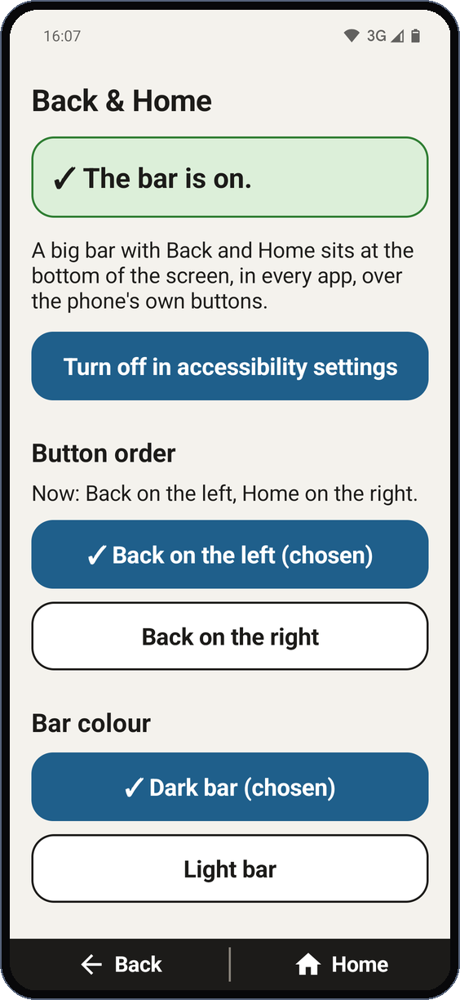

# SeniorNav

Big Back and Home buttons for Android, made for seniors.

A fixed bar at the bottom of the screen with two big buttons, **Back** and
**Home**, in every app (WhatsApp, the camera, the browser, ...). It lies over
the phone's own small navigation buttons. It cannot be moved or swiped away by
accident.

English and German. The app follows the phone's language.

[Deutsch weiter unten](#seniornav-deutsch)

## What you see

  

At the bottom of the screen, a dark bar:

- **← Back** on the left: one step back, like the phone's own Back button.
- **⌂ Home** on the right: straight to the home screen.

The bar steps aside on the lock screen. With the keyboard open, Back closes it.

## Install

1. Download the latest `SeniorNav-*.apk` from the
   [Releases](https://github.com/SeniorPhoneKit/SeniorNav/releases) page on the
   phone.
2. Open it. Android asks whether to allow installing from this source; allow it
   once.

Needs Android 8.0 or newer.

## Setting it up (for the helper)

1. Open **Back & Home**. It says whether the bar is on.
2. Tap **Open accessibility settings**, find **Back & Home** (often under
   "Downloaded apps"), open it and switch it on. Android asks for permission;
   allow it.
3. On Android 13 and newer, Android may say **"Restricted setting"**. Then go
   back to the app, tap **Open App info**, tap **⋮** at the top right, choose
   **Allow restricted settings**, and do step 2 again.
4. Switch the phone to **3-button navigation** (the app shows which mode is on
   and has a button for it; otherwise search Settings for "navigation"). The bar
   then sits exactly over the phone's own buttons. With swipe navigation, a swipe
   from the bottom edge still goes past the bar.
5. If the buttons are still too small, make everything bigger in Settings >
   Display > **Display size**.
6. Under **Button order**, choose **Back on the left** (the default) or **Back
   on the right**. The bar changes at once.
7. Under **Bar colour**, choose **Dark bar** (the default) or **Light bar**.

If the app later says **"turned on but not running"**, Android has stopped it:
switch it off and on again in accessibility settings. Some phone makers stop
apps to save battery; then also allow the app to run in the background in the
phone's battery settings.

When SeniorLauncher is installed and locked, this app hides its settings
buttons; unlock on the home screen to change them.

## With the home screen's lock (SeniorLauncher)

These settings are on the app's screen while the home screen is unlocked.

- **While unlocked** (default **Hide the bar while unlocked**): once a PIN has
  been set on the home screen, the bar steps aside while you have unlocked it,
  so you can use the phone's own buttons; it comes back as soon as the phone
  is locked again. The app's screen then says **"hidden while unlocked"**. A
  phone whose home screen was never locked keeps its bar.
- **Lock with the volume buttons**: tap **Record pattern** and press Volume
  Up and Down 4 to 6 times, mixing both (▲ ▲ ▼ ▼, for example), then **Save
  pattern**. Pressing it later, within 3 seconds and with at most 1 second
  between presses, locks the home screen and the Phone and Alarm apps, or
  unlocks them. The phone buzzes and says **Locked** or **Unlocked**. The
  volume moves while you press, as usual, and goes back to where it was once
  the pattern is complete. It locks with the home screen's PIN, so choose one
  there first (Settings, Lock). It works while the screen is on, not while the
  phone rings or during a call. **Remove pattern** switches it off.
- **Volume buttons while locked**: **Work normally** (default), **Stay within
  the limits** or **Do nothing**. The pattern still works with each. While the
  phone rings or during a call the buttons always work normally, and holding
  both buttons (Android's accessibility shortcut) is not affected.
- **Volume limits while locked** (with **Stay within the limits**): the
  lowest and highest ring and media volume, and the lowest alarm volume. A
  change made another way, for example with the slider, is brought back too.
  If the phone is switched to vibrate, the ring comes back on when it has a
  lowest volume; from silent only if you allow **Do Not Disturb access** (the
  app has a button for it).

Android warns more strongly when the bar is switched on, because the app may
see key presses: it only looks at Volume Up and Down, and only while one of
the settings above is in use.

## Backup of the settings

At the bottom of the app's screen (while unlocked), under **Backup**: **Save
settings to a file** keeps the button order, the bar colour, hiding while
unlocked, the volume pattern, what the volume buttons do while locked and the
limits in a file you choose (Downloads, Google Drive, …). **Load settings from
a file** puts them back, after a reset or on a new phone, once you confirm
**Replace**. The bar itself is switched on again in Accessibility settings, and
the lock (the PIN) stays SeniorLauncher's. SeniorLauncher can also save and load
the settings of every Senior app at once; either file works in either place.

## Good to know

- In landscape the bar stays at the bottom, also on phones whose own buttons
  move to the side.
- During full-screen videos the bar stays and covers the bottom edge of the
  picture. An automation app can pause it meanwhile (see below).

## Automation (Trigly, Tasker, …)

Other apps can control the bar, for example Trigly or Tasker: hide it while a
video app is open and show it again afterwards. Each command is a broadcast to
the package `app.phueber.seniornav`; extras are text.

| Send mode | Action | Extras | What it does |
|---|---|---|---|
| Broadcast | `app.phueber.seniornav.action.BAR_HIDE` | none | Pauses the bar: hidden until `BAR_SHOW`, also after a restart |
| Broadcast | `app.phueber.seniornav.action.BAR_SHOW` | none | Shows the paused bar again |
| Broadcast | `app.phueber.seniornav.action.BAR_SIDES` | `back` = `left` or `right` | Puts Back on that side, Home on the other |
| Broadcast | `app.phueber.seniornav.action.BAR_COLOUR` | `colour` = `dark` or `light` | Dark bar with white icons, or white bar with dark icons |
| Broadcast | `app.phueber.seniornav.action.BACK` | none | Presses Back (only while the bar's service is on) |
| Broadcast | `app.phueber.seniornav.action.HOME` | none | Presses Home (only while the bar's service is on) |
| Broadcast | `app.phueber.seniornav.action.BAR_UNLOCKED` | `hide` = `on` or `off` | Hide the bar while the home screen is unlocked, or keep it |
| Broadcast | `app.phueber.seniornav.action.VOLUME_KEYS` | `mode` = `normal`, `limits` or `off` | What the volume buttons do while locked |
| Broadcast | `app.phueber.seniornav.action.VOLUME_LIMIT` | `stream` = `ring`, `media` or `alarm`; `min` and/or `max` = a step (`max` also `top`; none for `alarm`) | Sets a volume limit, in the steps of the phone's slider |
| Broadcast | `app.phueber.seniornav.action.PATTERN_REMOVE` | none | Removes the volume-button pattern |

While the bar is paused, the app's screen says **"paused by automation"** and
has a button **Show the bar again**, also while SeniorLauncher is locked. On the
lock screen the bar is hidden anyway. Other values are ignored. There is no
command to unlock or to set a pattern.

`BACK`, `HOME` and `BAR_HIDE` are limited, so that no app can flood them: at
most one a second and six a minute; more and they are ignored for two minutes.
A rule that reacts to an app opening or closing stays well below that.

The settings backup has no command: saving and loading go through the file
picker, where the helper chooses the file, and loading replaces the settings
only after a confirmation.

**Example (Trigly):** trigger *App opened: YouTube*, action *Fire intent*, send
mode *Broadcast*, action `app.phueber.seniornav.action.BAR_HIDE`, package
`app.phueber.seniornav`. A second rule with *App closed: YouTube* sends
`app.phueber.seniornav.action.BAR_SHOW`.

## Privacy

The app has no internet access at all (it does not even ask for it), no
account, no tracking and no ads. It uses Android's accessibility service only
to press Back and Home, to notice when the lock screen shows and, if the
helper sets it up, to see presses of Volume Up and Down. It never reads what
is on the screen or any other key.

## Contributing and licence

Building, technical details and how to help: [CONTRIBUTING.md](CONTRIBUTING.md)
and [ARCHITECTURE.md](ARCHITECTURE.md). Licensed under the
[Apache License 2.0](LICENSE).

---

# SeniorNav (Deutsch)

Große Tasten für Zurück und Start auf Android, gemacht für Senioren.

Eine feste Leiste unten auf dem Bildschirm mit zwei großen Tasten, **Zurück**
und **Start**, in jeder App (WhatsApp, Kamera, Browser, ...). Sie liegt über den
kleinen Navigationstasten des Telefons. Sie lässt sich nicht aus Versehen
verschieben oder wegwischen.

Deutsch und Englisch. Die App folgt der Sprache des Telefons.

## Was man sieht

Unten auf dem Bildschirm eine dunkle Leiste:

- **← Zurück** links: einen Schritt zurück, wie die eigene Zurück-Taste.
- **⌂ Start** rechts: direkt zum Startbildschirm.

Auf dem Sperrbildschirm macht die Leiste Platz. Bei offener Tastatur schließt
Zurück die Tastatur.

## Installieren

1. Die neueste `SeniorNav-*.apk` auf der Seite
   [Releases](https://github.com/SeniorPhoneKit/SeniorNav/releases) auf dem
   Telefon herunterladen.
2. Öffnen. Android fragt, ob Installationen aus dieser Quelle erlaubt werden
   sollen; einmal erlauben.

Benötigt Android 8.0 oder neuer.

## Einrichten (für die helfende Person)

1. **Zurück & Start** öffnen. Die App zeigt, ob die Leiste an ist.
2. **Bedienungshilfen öffnen** antippen, **Zurück & Start** suchen (oft unter
   „Heruntergeladene Apps“), öffnen und einschalten. Android fragt nach der
   Erlaubnis; erlauben.
3. Ab Android 13 meldet Android eventuell **„Eingeschränkte Einstellung“**. Dann
   zurück in die App, **App-Info öffnen** antippen, oben rechts auf **⋮** tippen,
   **Eingeschränkte Einstellungen zulassen** wählen und Schritt 2 wiederholen.
4. Das Telefon auf die **Bedienung über 3 Schaltflächen** umstellen (die App
   zeigt, welche Art an ist, und hat eine Taste dafür; sonst in den Einstellungen
   nach „Navigation“ suchen). Dann liegt die Leiste genau über den eigenen Tasten.
   Bei der Bedienung über Gesten geht ein Wisch vom unteren Rand weiter an der
   Leiste vorbei.
5. Sind die Tasten noch zu klein, in Einstellungen > Display die
   **Anzeigegröße** erhöhen.
6. Unter **Reihenfolge der Tasten** **Zurück links** (Standard) oder **Zurück
   rechts** wählen. Die Leiste ändert sich sofort.
7. Unter **Farbe der Leiste** **Dunkle Leiste** (Standard) oder **Helle Leiste**
   wählen.

Zeigt die App später **„eingeschaltet, läuft aber nicht“**, hat Android sie
angehalten: in den Bedienungshilfen aus- und wieder einschalten. Manche
Hersteller beenden Apps, um Akku zu sparen; dann in den Akku-Einstellungen des
Telefons zusätzlich erlauben, dass die App im Hintergrund läuft.

Ist SeniorLauncher installiert und gesperrt, blendet diese App ihre
Einstellungstasten aus; zum Ändern auf dem Startbildschirm entsperren.

## Mit der Sperre der Startseite (SeniorLauncher)

Diese Einstellungen stehen auf dem Bildschirm der App, solange die Startseite
entsperrt ist.

- **Solange entsperrt** (Standard **Leiste ausblenden, solange entsperrt**):
  Sobald auf der Startseite eine PIN gewählt wurde, macht die Leiste Platz,
  solange Sie entsperrt haben, damit Sie die eigenen Tasten des Telefons
  benutzen können; sie kommt zurück, sobald wieder gesperrt ist. Der
  Bildschirm der App sagt dann **„ausgeblendet solange entsperrt“**. Ein
  Telefon, dessen Startseite nie gesperrt wurde, behält seine Leiste.
- **Mit den Lautstärketasten sperren**: **Muster aufnehmen** antippen und
  4- bis 6-mal Lauter und Leiser drücken, beide gemischt (zum Beispiel ▲ ▲ ▼ ▼),
  dann **Muster speichern**. Wird es später gedrückt, innerhalb von
  3 Sekunden und mit höchstens 1 Sekunde zwischen den Drücken, sperrt es die
  Startseite und die Telefon- und Wecker-App, oder entsperrt sie. Das Telefon
  vibriert kurz und zeigt **Gesperrt** oder **Entsperrt**. Die Lautstärke
  ändert sich beim Drücken wie gewohnt und springt zurück, sobald das Muster
  vollständig ist. Es sperrt mit der PIN der Startseite; wählen Sie dort also
  zuerst eine (Einstellungen, Sperren). Es funktioniert bei eingeschaltetem
  Bildschirm, nicht während das Telefon klingelt oder bei einem Anruf.
  **Muster entfernen** schaltet es aus.
- **Lautstärketasten, wenn gesperrt**: **Normal funktionieren** (Standard),
  **In den Grenzen bleiben** oder **Nichts tun**. Das Muster funktioniert bei
  allen dreien. Während das Telefon klingelt oder bei einem Anruf funktionieren
  die Tasten immer normal, und beide Tasten gedrückt halten (die
  Bedienungshilfen-Verknüpfung von Android) bleibt unberührt.
- **Lautstärkegrenzen, wenn gesperrt** (mit **In den Grenzen bleiben**):
  niedrigste und höchste Klingelton- und Medienlautstärke und die niedrigste
  Weckerlautstärke. Eine Änderung auf anderem Weg, zum Beispiel mit dem
  Schieberegler, wird ebenfalls zurückgeholt. Wird das Telefon auf Vibration
  gestellt, kommt der Klingelton zurück, wenn er eine Mindestlautstärke hat;
  aus „Lautlos“ nur, wenn Sie den **Zugriff auf „Bitte nicht stören“**
  erlauben (die App hat eine Taste dafür).

Android warnt beim Einschalten der Leiste deutlicher, weil die App
Tastendrücke sehen darf: Sie beachtet nur Lauter und Leiser, und nur, solange
eine der Einstellungen oben genutzt wird.

## Sicherung der Einstellungen

Unten auf dem Bildschirm der App (wenn entsperrt), unter **Sicherung**:
**Einstellungen in eine Datei speichern** bewahrt die Reihenfolge der Tasten,
die Farbe der Leiste, das Ausblenden im entsperrten Zustand, das Muster der
Lautstärketasten, was die Lautstärketasten gesperrt tun, und die Grenzen in
einer Datei auf, die Sie wählen (Downloads, Google Drive, …). **Einstellungen
aus einer Datei laden** holt sie zurück, nach einem Zurücksetzen oder auf einem
neuen Telefon, sobald Sie **Ersetzen** bestätigen. Die Leiste selbst schalten
Sie danach in den Bedienungshilfen wieder ein, und die Sperre (die PIN) bleibt
Sache von SeniorLauncher. SeniorLauncher kann auch die Einstellungen aller
Senior-Apps auf einmal sichern und laden; jede der beiden Dateien funktioniert
an beiden Stellen.

## Gut zu wissen

- Im Querformat bleibt die Leiste unten, auch auf Telefonen, deren eigene Tasten
  dann an die Seite wandern.
- Bei Videos im Vollbild bleibt die Leiste und verdeckt den unteren Bildrand.
  Eine Automatisierungs-App kann sie solange pausieren (siehe unten).

## Automatisierung (Trigly, Tasker, …)

Andere Apps können die Leiste steuern, zum Beispiel Trigly oder Tasker: sie
ausblenden, solange eine Video-App offen ist, und danach wieder einblenden.
Jeder Befehl ist ein Broadcast an das Paket `app.phueber.seniornav`; Extras sind
Text.

| Sendeart | Aktion | Extras | Was passiert |
|---|---|---|---|
| Broadcast | `app.phueber.seniornav.action.BAR_HIDE` | keine | Pausiert die Leiste: ausgeblendet bis `BAR_SHOW`, auch nach einem Neustart |
| Broadcast | `app.phueber.seniornav.action.BAR_SHOW` | keine | Zeigt die pausierte Leiste wieder |
| Broadcast | `app.phueber.seniornav.action.BAR_SIDES` | `back` = `left` oder `right` | Legt Zurück auf diese Seite, Start auf die andere |
| Broadcast | `app.phueber.seniornav.action.BAR_COLOUR` | `colour` = `dark` oder `light` (auch `dunkel`/`hell`) | Dunkle Leiste mit weißen Symbolen oder helle mit dunklen |
| Broadcast | `app.phueber.seniornav.action.BACK` | keine | Drückt Zurück (nur, wenn der Dienst der Leiste an ist) |
| Broadcast | `app.phueber.seniornav.action.HOME` | keine | Drückt Start (nur, wenn der Dienst der Leiste an ist) |
| Broadcast | `app.phueber.seniornav.action.BAR_UNLOCKED` | `hide` = `on` oder `off` (auch `an`/`aus`) | Leiste ausblenden, solange die Startseite entsperrt ist, oder zeigen |
| Broadcast | `app.phueber.seniornav.action.VOLUME_KEYS` | `mode` = `normal`, `limits` oder `off` (auch `grenzen`/`aus`) | Was die Lautstärketasten tun, wenn gesperrt |
| Broadcast | `app.phueber.seniornav.action.VOLUME_LIMIT` | `stream` = `ring`, `media` oder `alarm` (auch `klingelton`/`medien`/`wecker`); `min` und/oder `max` = eine Stufe (`max` auch `top`/`oben`; nicht bei `alarm`) | Setzt eine Lautstärkegrenze, in den Stufen des Schiebereglers |
| Broadcast | `app.phueber.seniornav.action.PATTERN_REMOVE` | keine | Entfernt das Muster der Lautstärketasten |

Solange die Leiste pausiert ist, sagt der Bildschirm der App **„durch
Automatisierung pausiert“** und hat eine Taste **Leiste wieder zeigen**, auch
wenn SeniorLauncher gesperrt ist. Auf dem Sperrbildschirm ist die Leiste ohnehin
ausgeblendet. Andere Werte werden ignoriert. Einen Befehl zum Entsperren
oder zum Setzen eines Musters gibt es nicht.

`BACK`, `HOME` und `BAR_HIDE` sind begrenzt, damit keine App sie massenhaft
senden kann: höchstens einer pro Sekunde und sechs pro Minute; darüber hinaus
werden sie zwei Minuten lang ignoriert. Eine Regel, die auf das Öffnen oder
Schließen einer App reagiert, bleibt weit darunter.

Für die Sicherung der Einstellungen gibt es keinen Befehl: Speichern und Laden
laufen über die Dateiauswahl, in der die helfende Person die Datei wählt, und
Laden ersetzt die Einstellungen erst nach einer Bestätigung.

**Beispiel (Trigly):** Auslöser *App geöffnet: YouTube*, Aktion *Intent senden*,
Sendeart *Broadcast*, Aktion `app.phueber.seniornav.action.BAR_HIDE`, Paket
`app.phueber.seniornav`. Eine zweite Regel mit *App geschlossen: YouTube* sendet
`app.phueber.seniornav.action.BAR_SHOW`.

## Datenschutz

Die App hat keinerlei Internetzugang (sie fragt nicht einmal danach), kein
Konto, kein Tracking und keine Werbung. Sie nutzt den Bedienungshilfe-Dienst von
Android nur, um Zurück und Start zu drücken, um zu bemerken, wann der
Sperrbildschirm gezeigt wird, und, wenn die helfende Person es einrichtet, um
Drücke auf Lauter und Leiser zu sehen. Sie liest nie, was auf dem Bildschirm
steht, und keine andere Taste.
